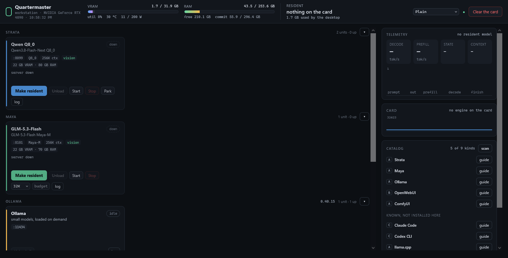
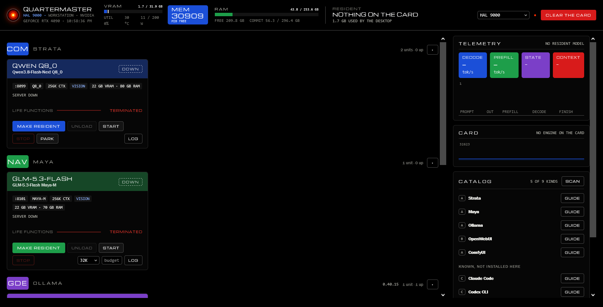
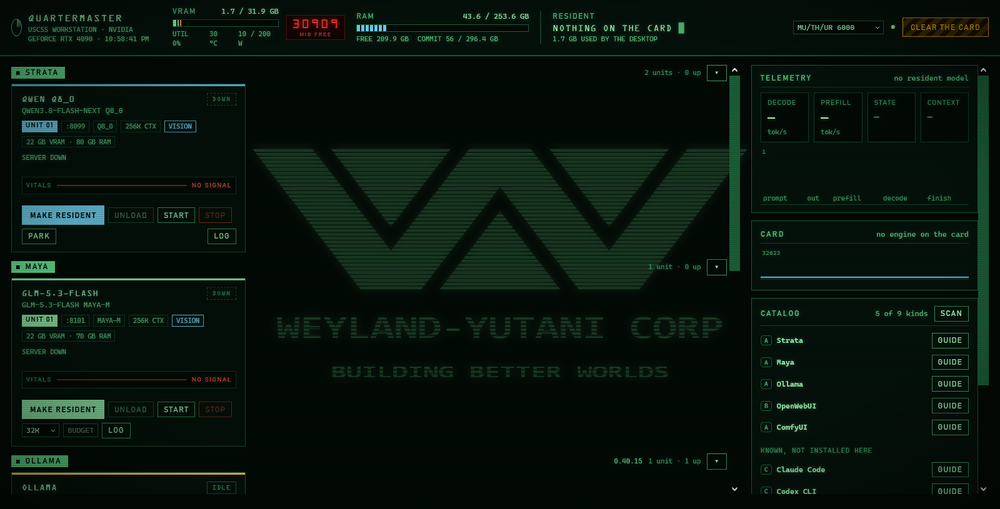
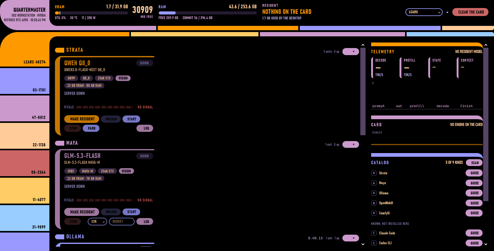
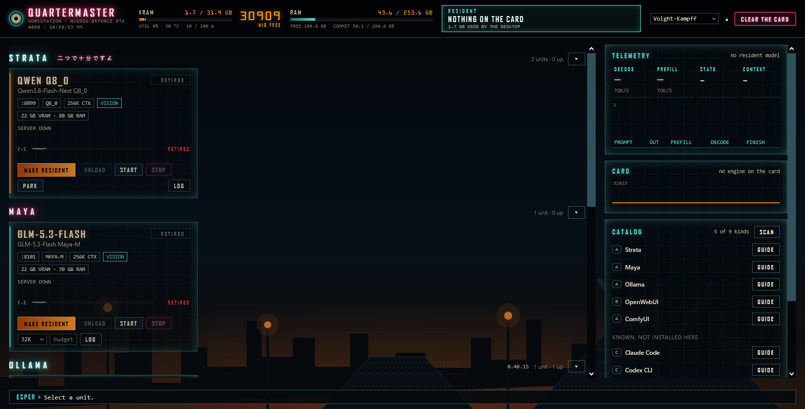

# Quartermaster

A dashboard for one machine that runs local inference: it shows what is on the GPU and in RAM, and makes a
model **resident** with one click, unloading whatever held the card first. It drives the engines through their
own APIs (Strata, Maya, Ollama), starts and stops the processes you have told it about, keeps ComfyUI and
OpenWebUI in view, runs **presets** (a whole working arrangement in one button), and dresses itself in
nineteen themes because a status page you look at every day should be a pleasure to look at.

It was built on one workstation and generalised so it can be installed on yours: `setup.py` finds what the
machine runs and writes the inventory; a catalog of kinds carries detection, update recipes and guides. It
runs on **Windows** (where it was built and is used daily) and on **Linux** through a platform module whose
branches were exercised under WSL Ubuntu and then on a Linux laptop running Ollama and a llama.cpp router on
Vulkan (2026-11-07); one NVIDIA GPU either way. Version 0.2.0; the design and what remains are in [SPEC.md](SPEC.md).



<p> </p>
<p> </p>

## How it is built

Two pieces, by design:

- **The host agent** (`agent/quartermaster_agent.py`): one Python process, standard library only, on
  `127.0.0.1:8790`. It polls the card (`nvidia-smi`), the RAM and every server in the inventory every two
  seconds, serves that state as JSON and as a Server-Sent-Events stream, and executes *plans*
  (`make_resident`, `unload`, `stop`, `start`, `park`, `set_context`, `set_budget`, `preset`, the ComfyUI and
  OpenWebUI ops, the art queue). Every mutating call needs a bearer key and is appended to
  `logs/actions.jsonl`.
- **The page** (`ui/`): static HTML, CSS and JavaScript, no build step. The agent serves it itself at 8790;
  `docker-compose.yml` also builds an nginx container on `127.0.0.1:8800` that serves the page and proxies
  `/api` to the agent, injecting the bearer key from a read-only mount so the browser never holds it.

The one rule that shapes everything: **the page sends intents, never commands.** An intent is an op name
and a server id. What that means on this machine (which executable, which arguments, which port, which
endpoint) is written in `agent/inventory.json` and nowhere else. The agent never starts anything that is not
in the inventory, and arguments come from the file, never from the request.

## Install

Requirements: Windows 10 or 11, or Linux with `ss` (iproute2); Python 3.11 or newer (nothing to
`pip install`); an NVIDIA driver (`nvidia-smi` is how the card is read); and optionally Docker for the
nginx container. The commands below are the same on both; where a step differs, the Linux form follows.

```bash
git clone https://github.com/lyricalvanity/quartermaster.git
```

```bash
cd quartermaster
```

1. Let setup find what the machine runs and write the inventory:

```bash
python agent/setup.py
```

   It reads the host (name, CPU, RAM, `nvidia-smi`), asks which kinds to look for (Strata, Maya, Ollama,
   llama.cpp, ComfyUI, OpenWebUI, Pi, Codex CLI, Claude Code), finds their installs and configuration
   files and any of them listening on a port, shows what it found, and writes `agent/inventory.json`,
   `agent/presets.json`, the bearer key `agent/agent.key` and the two launchers once you say yes.
   Nothing is written before that. Footprints, contexts and quants are yours to fill in afterwards:
   setup cannot measure them. `--yes` accepts every default; `--kinds ollama,comfyui` skips the
   checklist; `--skip <id>` leaves a proposal out. Later, `python agent/setup.py detect` re-scans and
   proposes only what the inventory does not have yet. `agent/inventory.example.json` shows the shape if
   you would rather write it by hand. All of these files are in `.gitignore`: they describe your machine
   and stay there.

2. Start the agent, in a console the first time so you see what it finds:

```bash
python agent/quartermaster_agent.py --debug
```

   Open <http://127.0.0.1:8790/>. That is the whole dashboard. For the container form:

```bash
docker compose up -d --build
```

   and open <http://127.0.0.1:8800/>. Rebuild after any edit under `ui/` (the page is baked into the
   image); the agent's own page at 8790 serves the live files.

3. To start the agent at logon: on Windows, copy the `Quartermaster Agent.cmd` setup wrote into your
   Startup folder (`shell:startup`); setup offers to do it. On Linux, setup writes
   `quartermaster.service`, a systemd user unit: copy it to `~/.config/systemd/user/` and
   `systemctl --user enable --now quartermaster`.

   What differs on Linux: per-process VRAM comes from `nvidia-smi --query-compute-apps` instead of the
   Windows GPU counter; servers start in their own session and stop with a group signal; OpenWebUI is
   driven through systemd instead of scheduled tasks: each control is a unit the agent starts by name
   with `--no-ask-password`. For a system unit under its own user, setup names three sealed root-owned
   control units, which `contrib/openwebui-systemd` provides with a polkit rule for the owner to install;
   for a user unit, it starts and stops that unit directly. How OpenWebUI is walled off stays beneath the
   units, and the agent reads only health, version and the controls' own log.

After editing the inventory: `POST /api/reload` with the bearer, or restart the agent. Two environment
variables exist for a second instance (a test, another port): `QM_HOME` points the agent at a directory
holding its own `inventory.json`, `presets.json` and `agent.key` (its logs go there too), and `QM_PORT`
changes the port; `setup.py --home DIR` writes such a directory.

## The inventory

Schema 2. A schema-1 file (`servers[]` with a `group` each, one `gpu`, presets inside) is migrated the
first time the agent loads it: the original is kept as `inventory.schema1.json` and the presets move to
`presets.json` beside it.

| key | what it is |
|---|---|
| `host`, `owner` | names shown in the header and used by the themes (`owner` is optional) |
| `gpus[]` | index, name, total MiB, and `free_card_mib`: below this much used, the card counts as free. The first one is the card the resident-model state machine manages |
| `ram_total_gib`, `pin_budget_gib`, `commit_warn_gib` | the RAM gauge and its warning lines |
| `policy` | `unload_ollama_on_resident`, `free_comfyui_on_resident`, `park_8099_default`, `humans_only` |
| `engines[]` | one per runtime, in the order the bands appear: `id`, `kind` (`strata`, `maya`, `ollama`, …), `name`, optional `root`, and one version source: `version` (a string), `version_file`, `version_cmd` (argv; the first version-looking token of its output) or `version_url` + `version_path` (a dotted JSON path). All local; read on a click or a reload, cached ten minutes |
| `units[]` | one per model server: `engine` names its engine; `kind` is `strata`, `strata-launch`, `maya`, `ollama`, `llamacpp` or `llamacpp-router` (one model of a llama.cpp router: `router_model` names it, load and unload go through the router, and the router is never stopped from the page); `start.argv` and `cwd`, or `start.systemd_user` for a server a systemd user unit keeps; `log`; `timeouts`; `footprint`; `legacy: true` folds it into the collapsed band |
| `shims[]` | small proxies that front a unit on another port (an Ollama-API shim for an OpenAI-style server, say) |
| `clients[]` | programs that consume the units (Pi, Codex CLI, Claude Code): executable, version command, and the local URLs their configuration points at. Written by setup; the page's client strip is a later stage |
| `openwebui` | optional tile; this driver runs three named Windows scheduled tasks (`tasks`) and reads health, version and two logs |
| `comfyui` | optional tile: start argv, port, the command-line text that identifies the process, an optional `update` section |
| `art` | optional queue of image batches that wait for the card (needs `comfyui`) |

`presets.json`: `{"presets": [{id, name, desc, steps: [{op, target, value}]}]}`. Presets are made in the
page: **+ New** opens an editor whose steps are picked from the ops the agent allows (`GET /api/presets`
serves that table: make resident, unload, clear the card, start, stop, park, context, thinking budget,
shims, ComfyUI and OpenWebUI start/stop) over the inventory's own ids; **Save current** opens it
pre-filled with what is resident, its context, and which shims and ComfyUI are up; the pencil on a preset
edits or deletes it. The agent checks a saved preset against the same table and writes `presets.json`
itself; the inventory file has no write path from the page. Each engine's band shows its version and unit
counts and has a menu: stop every unit of that engine, and the update entries below.

## Updates and the catalog

`catalog/<kind>.json` is one record per kind Quartermaster knows (what it is, licence, tier, how to detect
and drive it, its update recipe, how to install it, what it fits); it ships with the code and `git pull`
is how it updates. An engine or client takes its **update recipe** from its kind's record unless its
inventory entry overrides it (`"update": {"recipe": "git-check"}` for a custom build). Recipes:
`npm-global`, `pnpm-global`, `pip`, `winget`, `git-pull-pip-e`, `git-check`, `github-release`, `self`,
`script`, `comfy`, `driver`, `none` (`catalog/README.md`). Setup writes `pnpm-global` for a client that pnpm
installed although its kind's record says npm.

Every band and every client chip has **Check for an update** in its menu. That click is the only time
Quartermaster reaches the network (npm or pnpm, PyPI, GitHub, winget, `git fetch`); nothing checks on a schedule.
A check that finds a newer version shows it on the badge (`0.40.14 ↑ 0.40.15`) and, where the recipe can
apply it, an **Update to …** entry behind a confirmation: a backup where the recipe keeps one, apply,
verify, and a roll-back entry afterwards. An engine's units must be stopped first. A `git-check` or
`github-release` recipe is a check only and says "by hand". The last result per id is kept in
`logs/updates.json`.

**Clients** (Pi, Codex CLI, Claude Code) are a strip under the bands, not cards: version, the local ports
their configuration points at, a menu with the update entries. A unit card says `used by Pi` when a
client's configuration names its port, and the Stop dialog repeats it.

The **Catalog panel** (side column) lists what is installed with its tier and a **guide** per kind (what
it is, licence, what it fits and does not, install steps, what Quartermaster can and cannot do with it,
its update recipe, how it is found), the kinds known but not installed, and **suggestions**: rules over the
inventory and the state, nothing fetched (a card with no engine; engines with no front end or client;
ComfyUI without the art queue; several models and few presets; a client bound to a port nothing serves; a
unit without a footprint; an engine without a version source; an update a check found). **scan** reads the
machine once, on that click, and lists what detection sees that the roster lacks; nothing is written,
`qm detect` adds what you choose. `qm suggest` and `qm scan` do the same from a terminal. Themes colour the bands by slot (`--e1` … `--e6` in engine order, `--e0` for the
legacy band), so a theme never needs to know an engine's name.

## From a terminal

`agent/qm.py` talks to the agent with the same key:

```bash
python agent/qm.py status
```

`qm setup` and `qm detect` run `setup.py` (no agent needed). `qm resident <id>`, `qm unload <id>|all`, `qm start|stop|park|unpark <id>`, `qm context <n>`,
`qm budget <n>`, `qm preset <id>`, `qm shim <id> [--stop]`, `qm comfy start|stop|free|update|rollback`,
`qm art submit|list|run|drop`, `qm log <id>`, `qm history`, `qm cancel`. The docstring at the top of the
file is the manual.

## What it will not do

- **Leave the machine.** Both ports bind loopback. There is no telemetry, no update check and no fetch of
  any kind that you did not click for; the engine update buttons, when they land, run on a click and never
  on a schedule (a scheduled check will be an option, off by default).
- **Run anything it was not told about.** Executables and arguments come from the inventory file; the
  request supplies an op and an id. The page cannot edit the inventory.
- **Read what is not its business.** From ComfyUI it reads `/system_stats` and the queue count, never
  workflows, queue contents or outputs. From OpenWebUI it reads `/health` and `/api/version`. How much of
  the card a process holds comes from the operating system, not from the process.
- **Guess.** "Stop" ends a process and is a separate, labelled action the page sends with `confirm: true`.
  A server is unloaded through its own API, never by killing it.

The key is readable by any process running as you; it keeps the browser honest, not a hostile user. See
[SPEC.md](SPEC.md) for the threat model and what is deliberately out of scope.

## Themes

Pick one from the header; it is remembered per browser (`?theme=<id>` in the URL also works). Each theme is
one stylesheet scoped to `:root[data-theme="<id>"]`, so adding one touches nothing else. Several redress the
confirmation dialog, the start-up screen and the notices in their own voice; a few draw things (falling code,
rain, a honeycomb that pulses, a tracker sweep). Everything that moves stops under `prefers-reduced-motion`.

`aperture`, `bladerunner`, `castlevania`, `codec`, `concord`, `cortex`, `cyberpunk`, `gits`, `hal`,
`jurassic`, `lcars`, `magi`, `matrix`, `muthur`, `ocp`, `precrime`, `t800`, `tron`, `wopr`, and plain.

Fonts: the themes name display faces that ship with Windows and Office (Agency FB, OCR A Extended, Felix
Titling, Old English Text MT, Bahnschrift, Cascadia). They are used from the viewer's machine; if a browser
hides installed fonts from pages, drop your own copies into `ui/fonts/` (ignored by git) and `fonts.css`
will serve them. A machine without them (Linux, macOS) can map the names to faces it has in
`ui/fonts/local.css`, also ignored: one `@font-face` per name, with `url()` to copies in `ui/fonts/`. The
page loads it after `fonts.css`, so its rules win; where it does not exist, the agent and the container
serve an empty one. Michroma is included under the SIL Open Font License (`ui/fonts/OFL-Michroma.txt`).

The themes are homages. The names and marks they allude to belong to their owners and are used here as
fan reference only.

## Status

0.2.0 (see [CHANGELOG.md](CHANGELOG.md); releases are tagged `v0.x.y`). Built on one workstation in
November 2026 and in daily use there; the seven stages of the generalisation in [SPEC.md](SPEC.md) are done.
Tested on that machine and under WSL, and installed on a second machine, a Linux laptop, on 2026-11-07,
which is where 0.2.0 came from. What remains: detectors reading their conventions from the catalog records
instead of code, a systemd driver for engines kept as system units, more than one card, a fleet view across
several agents, the optional scheduled update check (off by default). Issues and pull requests welcome ([CONTRIBUTING.md](CONTRIBUTING.md)); the rules under "What it
will not do" are not up for negotiation ([SECURITY.md](SECURITY.md)).

## Licence

MIT. See [LICENSE](LICENSE).
